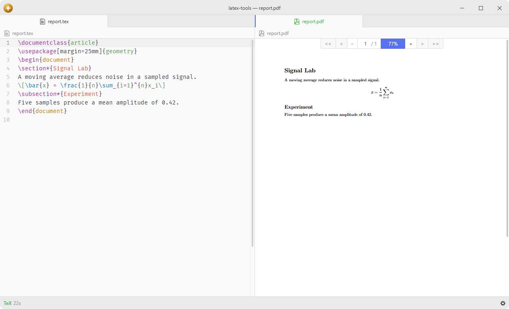

# latex-tools

Compile LaTeX documents with latexmk and view PDFs.

Includes SyncTeX support and LaTeX document discovery. The Tasks package runs compilation jobs, manages compile-on-save, collects output and publishes diagnostics.

## Features

- **Compilation**: build documents using `latexmk` with configurable engines.
- **Compile-on-save**: automatically recompile when an observed file is saved.
- **PDF viewing**: open PDFs internally via [pdf-view](https://github.com/lumine-code/pdf-view) or in an external viewer.
- **SyncTeX**: forward and backward search between source and PDF.
- **Linter integration**: error and warning reporting through the shared Tasks service with clickable references to source locations.
- **Multiple builds**: compile multiple files simultaneously with independent build states.
- **Magic comments**: per-file engine and root selection with `% !TEX program` and `% !TEX root`.

## Installation

To install `latex-tools` search for it in the Install pane of the Lumine settings, or run the command `lumine --install lumine-code/latex-tools`.

## Usage

This package requires `latexmk` and a LaTeX distribution to be installed on your system:

- **Windows**: [MiKTeX](https://miktex.org/download) (includes `latexmk`) or [TeX Live](https://www.tug.org/texlive/)
- **macOS**: [MacTeX](https://www.tug.org/mactex/) or `brew install --cask mactex`
- **Linux**: e.g. `sudo apt install texlive-full latexmk`

The [tasks](https://github.com/lumine-code/tasks) package must also be installed and enabled. It owns compilation jobs and file observation; LaTeX Tools registers its document provider through the shared Tasks service.

If `latexmk` is not in your PATH, set the full path in the package settings under **Path to latexmk**. The `latex-tools:global-rc` command opens your global `latexmkrc` file to customize `latexmk` behavior (e.g. glossaries support).

With **Clean auxiliary files after build** enabled, compilation runs normally, diagnostics are collected, and configured auxiliary files are removed only after success. The source, PDF and SyncTeX map are retained, and recorder dependencies remain available for compile-on-save.

The shared Tasks status-bar control shows active jobs, retained logs and observed documents for every provider. Use **Packages > LaTeX Tools** for LaTeX commands and **Observed Files** for the LaTeX-only list. Opening a PDF during a build waits for completion before showing the updated file. Multi-file projects are supported: the build root is resolved from `% !TEX root` magic comments, `.fls` recorder files, or by scanning for documents that include the current file.

PDF View uses LaTeX Tools' PDF build provider to resolve the source and rebuild it with F12 through Tasks without opening its panel, including existing PDFs with no build history.

The Tasks service owns file observation and automatic compilation. Automatic compilation pauses while an open source document uses the None grammar. Selecting None cancels its queued automatic build and interrupts its running build; choosing a grammar lets later file changes compile again. The file remains on the observed-files list, and explicit build and file operations remain available.

## Commands

Commands available in `lumine-workspace`:

- `latex-tools:global-rc`: open the global `latexmkrc` configuration file (creates it if missing),
- `latex-tools:observed-files`: list files observed for compile-on-save,
- `latex-tools:clear-all-observed-files`: stop observing all compile-on-save files,
- `latex-tools:compile`: compile the current LaTeX document using `latexmk`,
- `latex-tools:toggle-compile-on-save`: toggle automatic compilation when the active file is saved,
- `latex-tools:interrupt`: stop the current build process for the active file,
- `latex-tools:interrupt-all`: stop all running build processes,
- `latex-tools:clean`: remove auxiliary files generated during compilation,
- `latex-tools:clean-linter`: clear all linter messages,
- `latex-tools:kill-and-clean`: interrupt the build and clean auxiliary files,
- `latex-tools:open-pdf`: open the generated PDF in Lumine,
- `latex-tools:split-pdf-source`: open the PDF or its source in an adjacent pane,
- `latex-tools:synctex`: jump from source to corresponding PDF location (forward SyncTeX),
- `latex-tools:open-pdf-external`: open the generated PDF in an external viewer.

Commands resolve the active saved LaTeX file when dispatched from the menu or command palette.

Actions shown for `.latex-tools-observed-files-list`:

- `latex-tools:open-selected-file`: open the selected observed file,
- `latex-tools:open`: choose how and where to open the selected observed file,
- `latex-tools:open-external`: open the observed file in the configured external application,
- `latex-tools:show-in-folder`: reveal the observed file in the system file manager,
- `latex-tools:unobserve-selected-file`: stop observing the selected file,
- `latex-tools:clear-all-observed-files`: stop observing all compile-on-save files.

## Services

- [`latex.synctex`](docs/latex.synctex.md): provides forward and backward synchronization between LaTeX source and PDF.
- [`pdf-view.build-provider`](https://github.com/lumine-code/pdf-view/blob/master/docs/pdf-view.build-provider.md): resolves PDF ownership, validates restored source hints against the root PDF path, and routes PDF View builds through LaTeX Tools.
- [`tasks`](https://github.com/lumine-code/tasks/blob/master/docs/tasks.md): consumed to register the `latex-tools` provider and share compilation jobs, output, diagnostics, PDF artifacts and file observation.
- `open-external`: consumed to open generated PDFs in an external viewer.

## Contributing

Got ideas to make this package better, found a bug, or want to help add new features? Just drop your thoughts on GitHub. Any feedback is welcome!
